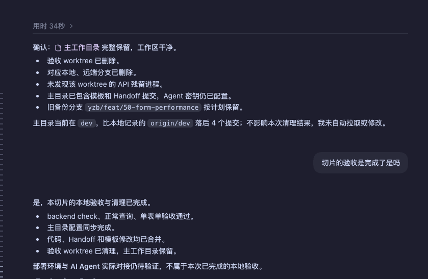
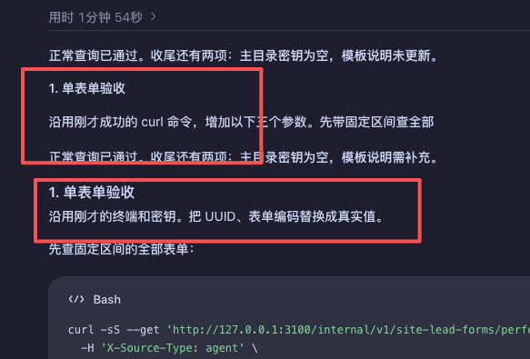

# AGENTS.md

让 AI 少说无用的话，让人少做不必要的操作。

这是一份可跨项目复用的 Agent 协作约定。
核心目标：**减少输出噪声，简化操作，用合适的形式讲清楚。**
规则正文见 [AGENTS.md](./AGENTS.md)。

## 核心能力

### 少一点噪声

- 结论先行：完成、未完成，或需要人决定什么。
- 常规核查自行完成，异常和阻塞才展开。
- 收尾直接报告结果，不用过程明细代替结论。

### 少一点操作

- 能安全只读查明的信息，由 Agent 先核实。
- 复用已有配置和标准命令，只指出缺失项。
- 先走最短正常路径，遇到实际问题再排查。

### 清楚一点

- 短句表达，一句一件事，同一概念用同一名称。
- 待办与步骤的数量、名称和顺序保持一致。
- 先判断事实，不迎合；不确定就说明。

### 四档输出

把规则中的“按 Karpathy 的四档”落实为四种表达形式，按需选用：

1. **文字**：借鉴 ASD-STE100，短句、一句一件事。
2. **图**：用图解释流程、结构和关系，少堆文字。
3. **页面**：需要交互时，用可调参数的页面探索变化。
4. **视频**：需要动态讲解时，用动画配合中文旁白。

## 使用范围

适用于支持 `AGENTS.md` 的 Agent，不依赖额外技能或插件。
本仓库保存原文，`~/.codex/AGENTS.md` 通过软链接读取。
日常在仓库修改、提交和推送，规则只维护一份。

以下案例来自实际协作；规则用于引导行为，不保证每次都能遵守。
截图、改写示例和接入步骤默认折叠，按需展开。

<details>
<summary>实践案例与截图</summary>

以下来自一次智能表单接口的开发与验收对话。截图是当时的问题输出；下面的改写是修订后的目标示例，不是伪造的运行结果。

### 1. 先让人知道做完没有

当时，AI 汇报了 worktree、分支、残留进程、配置和提交状态，却没有先回答“本次验收是否完成”。我只好再问一次。



改写后的目标：

> 本轮本地验收及清理已完成。
>
> 部署待办：部署环境与 AI Agent 联调仍待验证。

检查仍然要做，但常规细节不必逐项展示。有阻塞就明确说“验收尚未完成”，不能为了简短隐瞒问题。

### 2. 清单和步骤要对得上

当时，开头说“收尾还有两项”，下面第一步却是“单表单验收”。用户需要自己判断：这是第三件事，还是那两件事中的一件？



改写后的目标：

> 正常查询已通过。接下来还有三件事：
>
> 1. 验证单表单查询。
> 2. 补齐主目录密钥。
> 3. 补充配置模板说明。

后面按相同编号展开操作和成功标准。本轮之外的部署事项单列，避免读到结尾才发现又多了一项任务。

### 3. 启动命令保持正常

一次验收指导给出了这样的命令：

```bash
env -u PORT -u INTERNAL_SOURCE_SECRET_AGENT -u DATABASE_URL -u CMS_INTERNAL_BASE_URL -u CMS_SOURCE_SECRET_INTERNAL NODE_ENV=development pnpm --filter @ce-ops/api dev
```

实际需要的是：先直接检查 `.env` 中的必需项，再使用项目正常的启动命令。

```bash
pnpm --filter @ce-ops/api dev
```

只有确认 shell 变量覆盖配置时，才针对冲突项处理。不要让每次正常启动都承担排障流程。

### 4. 持久化配置，也可以简单

临时 `export` 能让本次启动成功，却不能证明下次启动或部署时仍然可用。反过来，补一个空配置项也不需要先备份两份完整文件。

我们最终采用的验收方式是：

1. 在当前 worktree 的实际配置文件中填写必需项。
2. 重启服务，验证配置生效。
3. 收尾时核对主工作目录，缺什么补什么。

已有有效值发生冲突时再确认。部署环境另列配置待办；本地 `.env` 不会随 Git 推送自动部署。

</details>

<details>
<summary>如何适配自己的项目</summary>

直接使用本仓库的 `AGENTS.md` 即可获得这些协作约定，无需安装额外技能。

- 按自己的习惯调整称呼、语气和工具偏好。
- 项目的启动方式、测试命令和业务约束，继续由项目文档维护。
- 保留项目已有规则，不用这份通用约定覆盖它们。

上面的接口验收是实践案例，用于说明规则如何减少噪声和操作负担，不是使用这份文件的前置流程。图表、页面和视频的实际生成能力取决于所用 Agent 及工具。

</details>

<details>
<summary>Codex 接入步骤</summary>

我的本地方式是：仓库保存原文，个人目录通过软链接读取。

```text
~/.codex/AGENTS.md
        ↓
~/repos/agentsmd/AGENTS.md
```

克隆仓库：

```bash
git clone https://github.com/hinson0/agentsmd.git ~/repos/agentsmd
```

先检查 `~/.codex/AGENTS.md`。若已有文件，先对比并合并自己的规则，保留原文件后再建立链接；已有正确链接则跳过。

在目标路径空闲时执行：

```bash
mkdir -p ~/.codex
```

```bash
ln -s ~/repos/agentsmd/AGENTS.md ~/.codex/AGENTS.md
```

以后直接修改仓库里的 `AGENTS.md`，软链接会读取同一份内容。通过 Git 提交和推送保存版本；不要用个人文件覆盖项目已有的规则。

这份文件包含我的称呼、语气和工具偏好。复用前请按自己的习惯调整。

</details>
